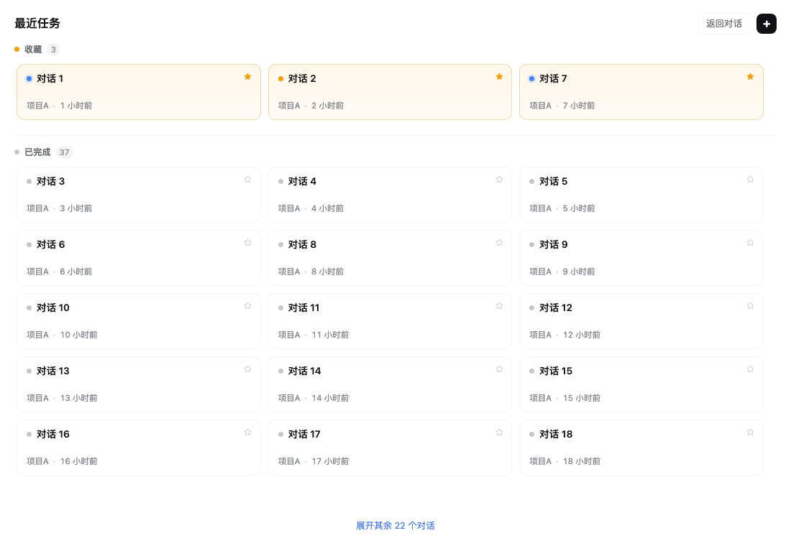

# dsh-recent-tasks · 最近任务

仓库：<https://github.com/lnqxyz/dsh-recent-tasks> · 问题与建议：<https://github.com/lnqxyz/dsh-recent-tasks/issues>

DSH 侧栏里一块常驻的「最近任务」面板：正在跑的、等你确认的、收藏的、还没看的、已完成的会话分区排开，点一下回对话；点【+】在记住的文件夹里直接开新会话，并归进那个工作区，而不是「未分组」。

宿主自带侧栏只列标题，看不出「在跑」「跑完我还没看」「我看过了」。这个插件补的就是这层状态。

配色按状态分：运行**浅蓝且在流动**、未读**绿**、收藏**琥珀**、等你处理**红**、已完成**灰**。




## 四个区（从上到下）

| 区 | 样子 | 进这里的条件 |
| --- | --- | --- |
| 正在运行 | **浅蓝**卡片，一道光带在卡面上来回流过、边框有光点绕行、左上蓝点呼吸，带浮动阴影 | 会话正在跑；**正在等你确认**的排在最前，红卡、标题红闪、红色小标「等你确认 / 等你定方案 / 等你回答」，区块标题右侧还有「待你处理 N」 |
| 收藏 | 琥珀色卡片，右侧中间一颗 30px 的实心琥珀星（常驻一层柔光；按钮 56px 见方，点它周围哪儿都算点星） | 点亮星星就在这；**互斥**——进了收藏就不在其它三区，取消收藏立即回原区；同一张卡四个区都能点星；**没有收藏时整块不出现**（标题也不占位）。收藏把四种状态混在一个区里，所以**每张卡自己写明状态**：运行中（蓝标）、未读（绿标）、已完成（灰标），左上小点同色；等你确认的不加状态标，仍用红标写「等你确认 / 等你定方案 / 等你回答」 |
| 未读 | **绿色**卡片 | 某一轮跑完了，而那一轮你没看着；**按轮算**，打开即清，重跑会离开未读，星标不算「看过」 |
| 已完成 | 灰色卡片，最后一行「展开其余 N 个对话」 | 其余的；默认 15 条，每次 +10，全部展开后变【收起】；**每次进入面板回到 15 条** |

卡片整体比早先大一号：标题 16px、说明 12.5px、卡片最小高度 100px；一行**最多三列**，窗口变窄自动降到两列、一列，不再把字挤小。每张卡右侧中间有一颗 30px 的星星，竖向居中，点击区 56×56，点哪儿都行；未收藏时它是一枚 34% 透明度的灰线，鼠标划过卡片或指针移到星上时才变清楚——列表静止时不会被一排星标切开；收藏后变成实心琥珀星并带一圈柔光。文字给它让开 64px，长标题不会钻到星星底下。

**哪个区没有会话，哪个区就整块收起**：标题、计数、说明、上下分隔线一起消失，下面的区直接顶上来，中间不留空位。所以页面上可能只有两个区、一个区，甚至四个区都不同时在（全都进了收藏、全在跑、或者一条都没跑完）。一个会话都没有时整页显示「最近 10 天没有会话」，【+】仍在右上角。

## 数据从哪来

- **会话列表**：宿主 `sessions.list`。只取最近 10 天有活动的，按最后一条消息的时间从新到旧；`subagent` 派生会话不列；已归档不列。
- **运行 / 待确认 / 未读**：宿主 `uiSession.sessionStatus`（`running`、`pendingInteraction`、`completionUnread`）。待确认的三种文案直接读 `pendingInteraction.kind`，不自己发明规则。
- **「看过没有」按可见性算**：对话真的占着主区域才算看过。点开又点回最近任务（或面板盖住对话）不算看过——所以「运行中打开瞄一眼、回到列表、它在后台跑完」会进未读；真盯着对话看它跑完则直接进已完成。
- **收藏 / 未读 / 记住的文件夹**：只存浏览器本地（见下表），不上传、不跨设备同步。
- 超过 10 天的收藏仍留在收藏里（窗口只约束未读与已完成）；这时取消星标，它会直接消失——它已经不在窗口内了。

## 点【+】新建会话

1. **第一次**点击弹选择框：列出现有工作区，另有「选择其他文件夹…」调系统文件夹选择器（宿主 `uiWorkspace.pickDirectory`）。
2. 选中的文件夹被记住。它是已有工作区 → 直接在那个分组里新建会话并打开；不是工作区 → 先 `workspaces.create` 登记成工作区，再 `connectWorkspace` 建会话并打开。于是会话归入该分组，不会掉进「未分组」。
3. **之后**点【+】不再弹窗，直接用记住的文件夹。
4. 记住的文件夹被删 / 改名后就不可用，下次点【+】回到第 1 步重新选。

> 想主动换文件夹：目前没有独立按钮，只能等记住的那个失效后重新选，或清掉本地键 `dsh.recent-tasks.folder.v1`。

## 进面板时顺带解锁刷新

点侧栏「最近任务」时，先问宿主 `/dsh-unlag/graph` 当前服务的插件代码修订号，跟页面启动时记下的比：

- 一样 → 直接进页面，不折腾；
- 不一样、读不到、或 1.5 秒没回 → 借用界面右上角「解除卡顿」按钮触发一次整页重建，重建完自动回到最近任务页（`sessionStorage` 记一个 120 秒内有效的意图）；
- 宿主拒绝重建（正在发消息、有未发附件、开着弹窗等）→ 不解释，直接进页面，下次再说。

这样改完插件代码点一下入口就能看到新版本。代价是那一次多花约 3 秒。

## 本地存储

| 键 | 位置 | 存什么 |
| --- | --- | --- |
| `dsh.recent-tasks.folder.v1` | localStorage | 【+】用的文件夹绝对路径 |
| `dsh.recent-tasks.favorites.v1` | localStorage | 收藏的会话 id 列表 |
| `dsh.recent-tasks.unread.v1` | localStorage | 未读的会话 id 列表 |
| `dsh.recent-tasks.reopen.v1` | sessionStorage | 刷新重建后要回到本页的意图（120 秒过期） |

清掉这几个键就回到初始状态：没有收藏、没有未读、下次点【+】重新选文件夹。

## 文件

```
client.js              全部界面与逻辑（浏览器侧，约 1600 行）
index.js               Host 半边：空实现，只为让 bundle patch 能把它插进组合
package.json           包名带本机随机 id，宿主按这个名字查文件
cordis.patch.yml      让宿主把这包插进组合的一行 patch
icon.svg              侧栏图标
locale/zh.json         侧栏入口的中文名与描述（界面文案在 client.js 里，中英各一份）
locale/en.json         同上，英文
tools/build-harness.cjs   生成一个用假宿主跑 client.js 的自检页
tools/run-harness.mjs     无头 Chrome 打开自检页，打印每条检查结果
tools/sync-to-dsh.sh      把仓库文件同步进本机 DSH 实际加载的目录
```

## 装法（本机）

这份仓库是**源码**。界面实际加载的是 DSH 插件创建器产出的那份副本，profile 里用 `link:` 指向它：

```
~/.dsh/profiles/desktop/package.json
  "@dsh-local/view-8c716ee6-…": "link:…/created-plugins/8c716ee6-…"
```

所以改完（或拉下新版本）之后：

```bash
node tools/build-harness.cjs
node tools/run-harness.mjs "file://$PWD/临时/harness.html"   # 打印每条检查，期望 ALL PASS
tools/sync-to-dsh.sh                                        # 同步进加载目录（顺带 node --check）
```

然后点界面右上角那个打圈的刷新按钮（解除卡顿）。或者干脆点侧栏「最近任务」——它检测到代码变了会自己刷一次。

`tools/sync-to-dsh.sh --check` 只对比不写，用来确认两边是否一致。

## 自检

`tools/build-harness.cjs` 用一套假服务（会话列表、工作区、布局、`uiWorkspace`、`uiSession`）在普通浏览器里渲染 `client.js`，并跑 184 条检查：分区归属、收藏互斥、未读按轮与可见性、待确认排位与配色、四区配色与动效（运行蓝且在动、未读绿且不动、待确认不跟着动）、空区整块收起（含顶上来时不带多余分隔线）、**卡片放大与收藏星（三列封顶、点击区 56px 见方、图标 30px、贴右 4px、竖向居中、未收藏时不带常驻底色、标题与说明让位、字号、窄宽度降列）**、**收藏卡状态标（运行中偏蓝、未读偏绿、已完成灰、待确认不重复加标、其它区不加标）**、`+` 的文件夹记忆与失效回退、展开条数、刷新桥的拒绝路径等。结果写在页面 `<title>` 和底部日志里。

- `临时/harness.html`：跑检查
- `临时/harness.html?preview`：静态浅色预览
- `临时/harness.html?preview&dark`：静态深色预览
- `临时/harness.html?preview&unread`：三区都有的样子
- `临时/harness.html?preview&none`：一个都不在跑（只剩已完成）
- `临时/harness.html?preview&favrun`：正在跑的都进了收藏（运行区收起，收藏在最上面）
- `临时/harness.html?preview&favstatus`：收藏里四种状态各一张卡（运行中 / 未读 / 等你确认 / 已完成）
- `临时/harness.html?preview&unread&freeze=1.1`：把动画停在 1.1 秒处再截图，用来核对流动光带的位置

截图里是假数据（对话 1…20、项目A），只用于看形状与配色。

## 它不做什么

- 不改动会话本身：不迁移、不重命名、不归档、不删除，只负责打开。
- 不做会话检索、全文搜索、导出。
- 不跨设备同步收藏与未读；换浏览器就是另一份。
- 只列最近 10 天有活动的会话（收藏除外），更老的会话请用宿主侧栏。

## 已知边界

- **宿主接口名绑定**：依赖 `sessions` / `workspaces` / `uiWorkspace`（`openSession`、`connectWorkspace`、`pickDirectory`、`listDirectory`）/ `uiSession.sessionStatus` / `layout.panelInfo`、`layout.selectPanel` / `slots` / `locale`，以及 dsh-unlag 的 `/dsh-unlag/graph`。DSH 换版本时这些名字可能变，坏了先查这一层。
- **包名里的随机 id 是本机生成的**：`@dsh-local/view-8c716ee6-17d5-46ae-b021-c82f36d0f6c1`。换一台机器装，要么沿用这个 id，要么把 `package.json`、`cordis.patch.yml`、`client.js` 顶部 `id` 三处一起改。
- **取色用 DSH 主题变量**（`--dsw-alias-*`）；离开宿主渲染（自检页）时用 fallback 调色板，只保证可读，颜色不等于真机。
- 侧栏「取消固定」状态只存内存，整页重建后会复原；这是宿主行为，本插件没有干预。

## 版本

`0.1.0` — 开发中，未发布到插件市场。

## 许可

MIT
