# dsh-recent-tasks · 最近任务

仓库：<https://github.com/lnqxyz/dsh-recent-tasks> · 问题与建议：<https://github.com/lnqxyz/dsh-recent-tasks/issues>

DSH 侧栏里一块常驻的「最近任务」面板：正在跑的、等你确认的、收藏的、还没看的、已完成的会话分区排开，点一下回对话；点【+】在记住的文件夹里直接开新会话，并归进那个工作区，而不是「未分组」。

宿主自带侧栏只列标题，看不出「在跑」「跑完我还没看」「我看过了」。这个插件补的就是这层状态：面板里分四区，侧栏入口上还挂三个小药丸，不用点进来就知道有没有事（见「侧栏入口上的三个小药丸」）。

配色按状态分：运行**浅蓝且在流动**、未读**绿**、收藏**琥珀**、等你处理**红**、已完成**灰**。

页头右侧有【只留 N 天】：一次把 N 天以前的会话归档，页面上只留下最近 N 天的（归档可恢复，不删任何东西）。N 只在**插件设置**里改，页面上改不了。归档完页面顶部会出现一条**撤销条**，30 秒内点【撤销】就能把那批会话原样还回去。

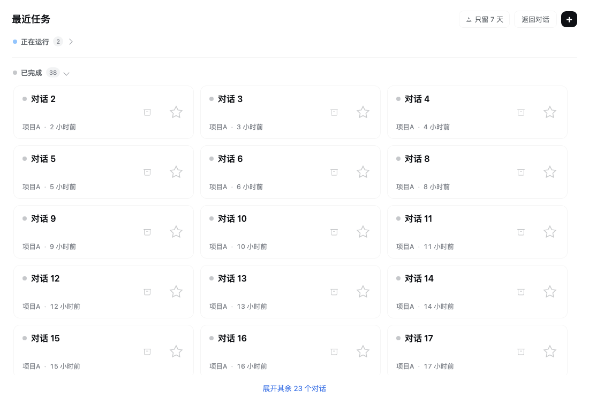
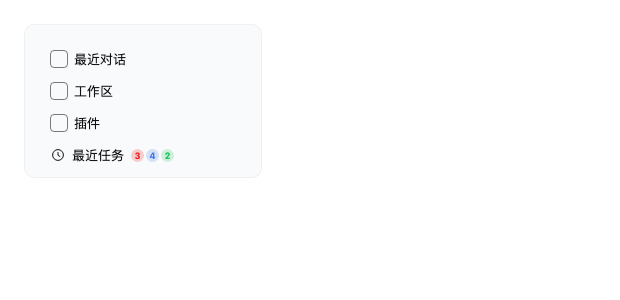
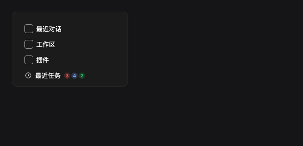

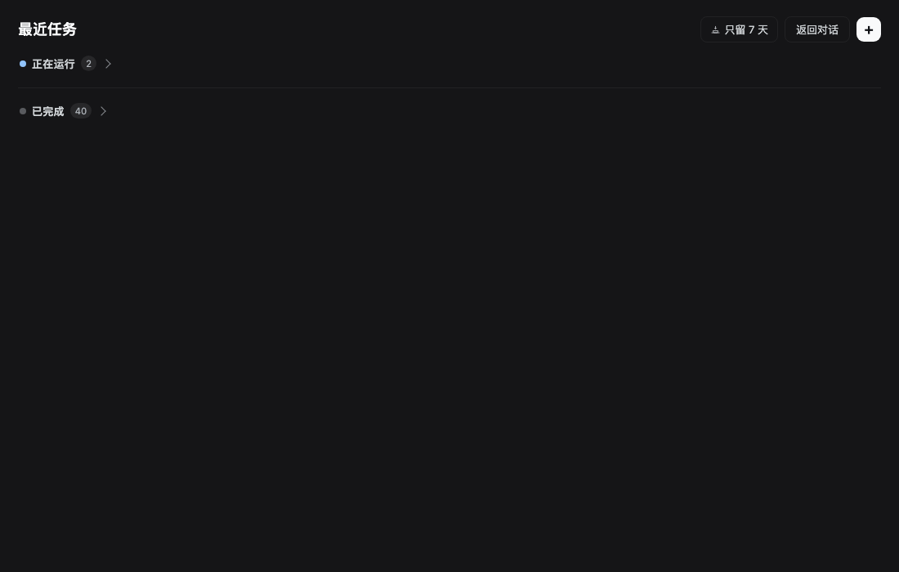
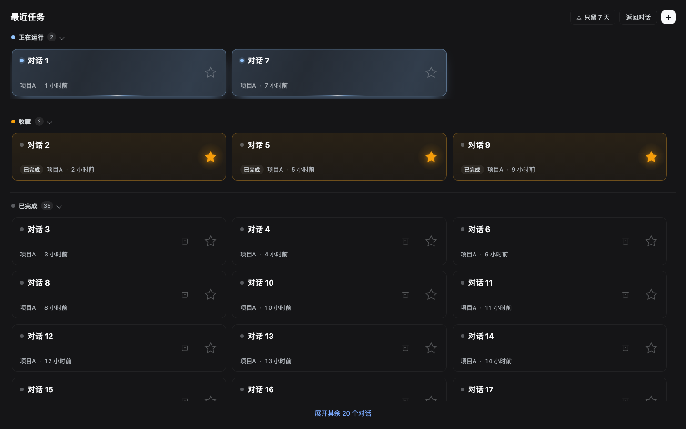
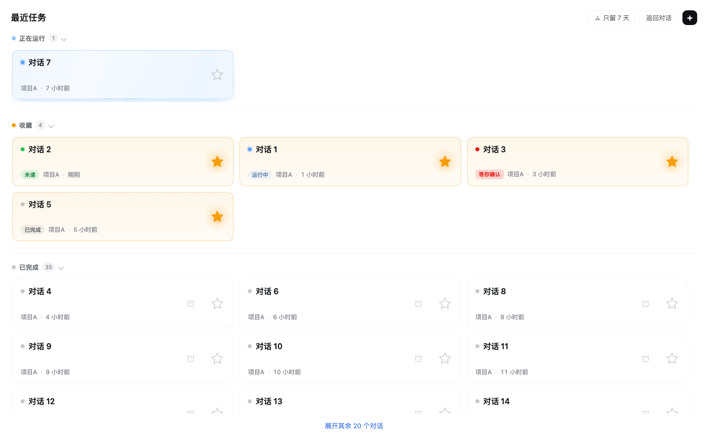

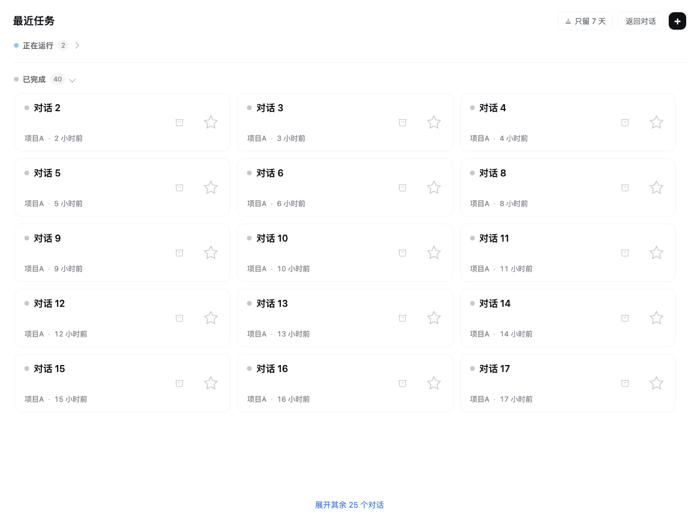
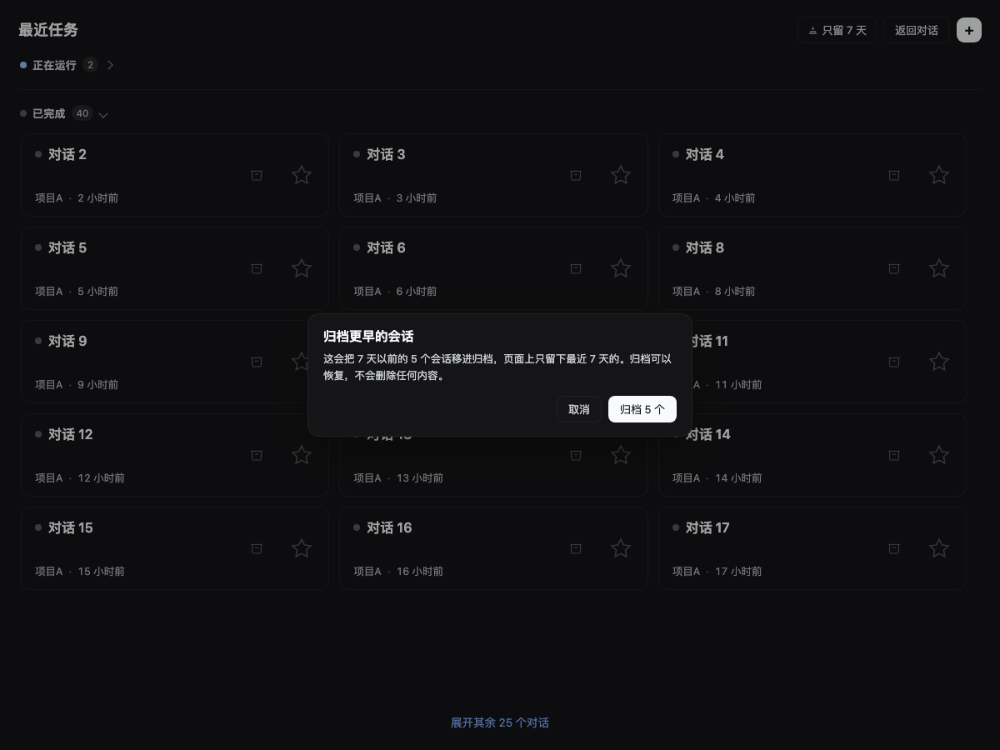
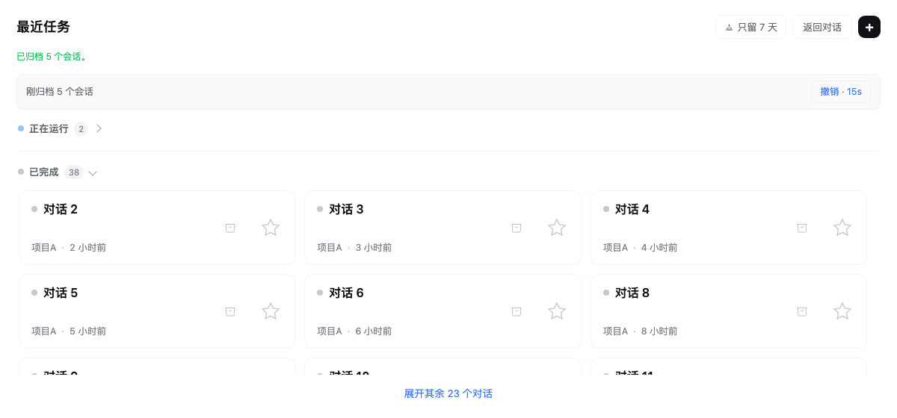


## 四个区（从上到下）

| 区 | 样子 | 进这里的条件 |
| --- | --- | --- |
| 正在运行 | **浅蓝**卡片，一道光带在卡面上来回流过、边框有光点绕行、左上蓝点呼吸，带浮动阴影 | 会话正在跑；**正在等你确认**的排在最前，红卡、标题红闪、红色小标「等你确认 / 等你定方案 / 等你回答」，区块标题右侧还有「待你处理 N」 |
| 收藏 | 琥珀色卡片，右侧中间一颗 30px 的实心琥珀星（常驻一层柔光；按钮 56px 见方，点它周围哪儿都算点星） | 点亮星星就在这；**互斥**——进了收藏就不在其它三区，取消收藏立即回原区；同一张卡四个区都能点星；**没有收藏时整块不出现**（标题也不占位）；有收藏时标题行可收起、**默认收起**——除非里面有人等你处理，那时进面板就是展开的（见「收起与展开」）。收藏把四种状态混在一个区里，所以**每张卡自己写明状态**：运行中（蓝标）、未读（绿标）、已完成（灰标），左上小点同色；等你确认的不加状态标，仍用红标写「等你确认 / 等你定方案 / 等你回答」 |
| 未读 | **绿色**卡片 | 某一轮跑完了，而那一轮你没看着；**按轮算**，打开即清，重跑会离开未读，星标不算「看过」 |
| 已完成 | 灰色卡片，右侧中间两颗按钮：**归档**（纸箱）与**收藏**（星）；最后一行「展开其余 N 个对话」 | 其余的；默认 15 条，每次 +10，全部展开后变【收起】；**每次进入面板回到 15 条** |

卡片整体比早先大一号：标题 16px、说明 12.5px、卡片最小高度 100px；一行**最多三列**，窗口变窄自动降到两列、一列，不再把字挤小。每张卡右侧中间有一颗 30px 的星星，竖向居中，点击区 56×56，点哪儿都行；未收藏时它是一枚 34% 透明度的灰线，鼠标划过卡片或指针移到星上时才变清楚——列表静止时不会被一排星标切开；收藏后变成实心琥珀星并带一圈柔光。文字给它让开 64px，长标题不会钻到星星底下。

**哪个区没有会话，哪个区就整块不出现**：标题、计数、说明、上下分隔线一起消失，下面的区直接顶上来，中间不留空位。所以页面上可能只有两个区、一个区，甚至四个区都不同时在（全都进了收藏、全在跑、或者一条都没跑完）。一个会话都没有时整页显示「最近 10 天没有会话」，【+】仍在右上角。

### 收起与展开

收藏与正在运行这两个区可以收起来，未读区不能。**刚进面板时这两个区收着、已完成区是展开的**——因为已完成区多半是你回来收拾、重开或归档的地方，进面板就该看见那几张卡，而不是先去点一下标题行；其余情况点标题行展开。另有一个例外：**哪个区里有人在等你，那个区就替你展开**。

- 点**标题行任意位置**都能切换，不只有右边那个小三角。三角收起时朝右、展开时朝下。
- 收起后只剩一行标题，卡片和「展开其余 N 个对话」一起下去，不占正文高度。
- **收起也在数**：正在运行区照旧写「正在运行 N」，有待你处理的还按红色写「待你处理 N」；收藏区写「收藏 N」；已完成区写「已完成 N」。所以收起来不会让「有几个在跑、有几个在等我」变得看不见。
- 未读区永远展开，有会话直接把卡片列出来，标题行上没有三角。
- **这个状态不记**：不写本地存储、不进设置。点侧栏入口重新进来、或者刷新页面，各区重新按到达规则收放（已完成回到展开的 15 条）。
- 收起和上面「没有会话的区整块不出现」是两回事：一个区连一条会话都没有时，标题行也不出现——没什么可收起的。

#### 有人等你的时候，那个区替你展开

「有人在等」= 会话停在那里等你确认、等你定方案、或者等你回答，也就是卡片上写了红标「等你确认 / 等你定方案 / 等你回答」的那几种。它们不往前走是因为缺你一句话，所以进面板时不该再让你先去点一下标题行。

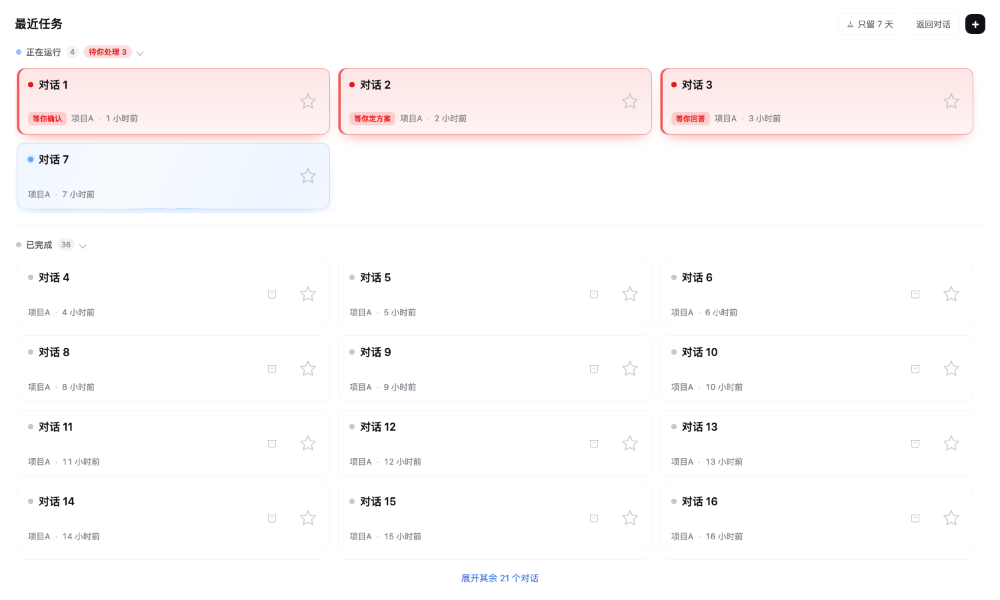
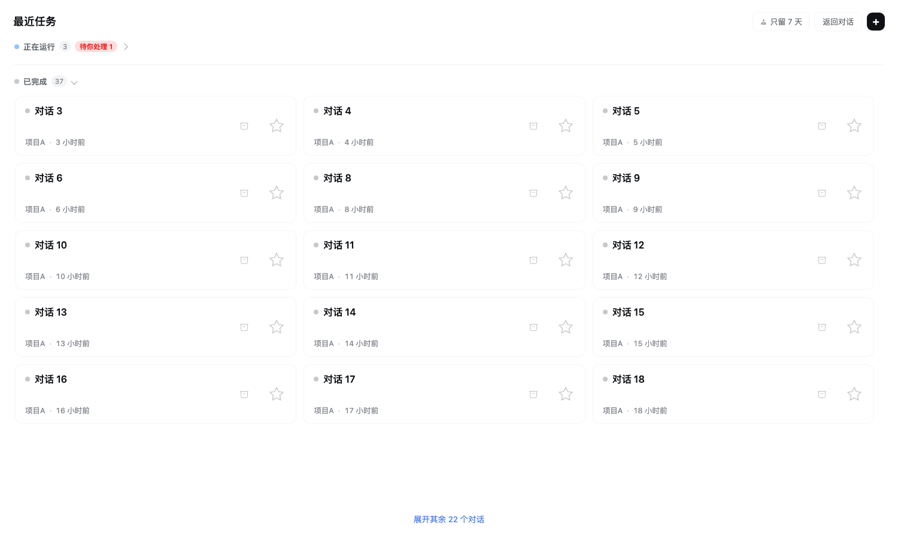
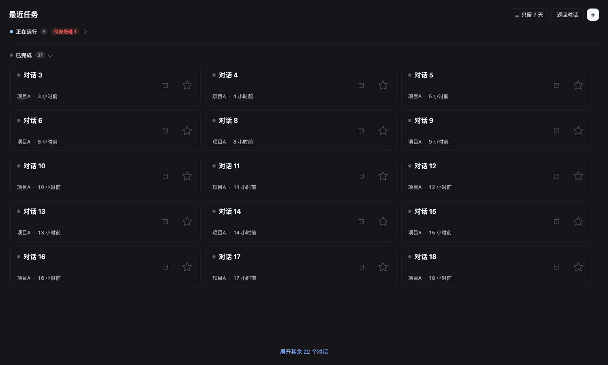

- 正在运行区和收藏区**各判各的**：等你的在运行区，就展开运行区；你把它收进收藏了，就展开收藏区。一个会话只在一个区里，所以不会两个区同时为一个会话弹开。
- **已完成区不受这条规则影响**——那里面没有人在等你，它按上面那条固定规则默认展开。
- **只判「进到这一页」的那一刻**：刚打开面板、点侧栏入口重新进来、刷新页面。页面已经开着你面前的时候，某个会话才转成等你处理，标题行会立刻冒出红色「待你处理 N」，但**不会自己弹开**把卡片顶到鼠标底下；点一下标题行就能看见。
- 「在跑但很久没动静」不算：DSH 不提供这个信号，按时间猜会把跑得久的长任务误判成卡住。所以只认真正的「等你处理」。
- 这条例外也不写本地存储，和折叠状态一样，每次到达重新判。

> 已完成区里那个「展开其余 N 个对话」管的是**卡片的条数**（15 条起，每次 +10）；标题行的三角管的是**整个区**收不收。两个都能单独动，互不影响。

### 侧栏入口上的三个小药丸

侧栏那颗「最近任务」图标旁边会跟着冒数字，不用点进来就知道有没有事：

| 颜色 | 数的是 | 数到 0 时 |
| --- | --- | --- |
| 红 | 正在等你处理（等你确认 / 等你定方案 / 等你回答） | 这一颗不画 |
| 浅蓝 | 正在运行 | 这一颗不画 |
| 绿 | 跑完了你还没点开看 | 这一颗不画 |

- 三个都排着长队时从左到右是**红、浅蓝、绿**：最急的在最前。
- **数为 0 就整颗不出现**，三颗都 0 就什么也不画，入口跟原来一样只有图标。所以「一个数字都没有」本身就是一句话：没事。
- 鼠标停在药丸上会写清楚，例如「2 个正在运行」「1 个跑完了没看」。
- **收藏里的也算**：一个会话被你点亮星星之后，页面上它挪去了收藏区、不再出现在「正在运行」里，但入口照旧把它数进蓝的——收藏是「我要留着」，不是「我看过了」。
- **收藏里跑完没看的也算进绿的**：口径同上，收藏只是换了个位置放，不是打过卡。所以收藏区里一个没点开过的会话，入口绿的照样加一（页面的未读区不含收藏，两处口径不同，是有意为之）。
- 侧栏收窄成一条图标栏时不画这几个数字：那格只有 36×36 px，塞不下，数字会盖住图标。展开侧栏就回来。
- 数字从插件装载起就在数，不用先把面板打开一次。
- 和页面的三个区一样，这层数字**不记本地存储**。

数字排在「最近任务」四个字**后面**，跟文字同一条线，不是挤在图标上。做法是把插件那一格和行里的两个 span 摊平成同一条 flex 行，再让药丸的 `order` 排在文字之后——不靠绝对定位、不写死像素，所以「最近任务」四个字多长、数字有几个，位置都自己算。代价是这条 CSS 认的是宿主行「图标一格 + 文字一格」的结构，宿主换版本动了这层结构就得跟着改；自检里有一条几何检查（药丸左边缘必须落在四个字右边缘之后）专门盯这个。

## 数据从哪来

- **会话列表**：宿主 `sessions.list`。只取最近 10 天有活动的，按最后一条消息的时间从新到旧；`subagent` 派生会话不列；已归档不列。
- **运行 / 待确认 / 未读**：宿主 `uiSession.sessionStatus`（`running`、`pendingInteraction`、`completionUnread`）。待确认的三种文案直接读 `pendingInteraction.kind`，不自己发明规则。
- **「看过没有」按可见性算**：对话真的占着主区域才算看过。点开又点回最近任务（或面板盖住对话）不算看过——所以「运行中打开瞄一眼、回到列表、它在后台跑完」会进未读；真盯着对话看它跑完则直接进已完成。
- **收藏 / 未读 / 记住的文件夹**：只存浏览器本地（见下表），不上传、不跨设备同步。
- 超过 10 天的收藏仍留在收藏里（窗口只约束未读与已完成）；这时取消星标，它会直接消失——它已经不在窗口内了。

## 只留 N 天（归档更早的会话）

页头「最近任务」右边的【只留 N 天】。点了先弹一个确认框，写明要归档几个，确认后才动手。规则：

- **归档，不删除**。走宿主 `uiWorkspace.archiveSession`，跟宿主侧栏「归档」是同一件事，能在归档管理器里恢复。
- **收藏的不动**。收藏本来就是「我要留着」，N 天以外的收藏继续留在收藏区（确认框会写明有几条这样被留下）。
- **还在跑的不动**。页面不会为了清列表去停一个正在干活的会话；它们在确认框里单独计数，等跑完下次再清。
- **N 天整以内的一律不动**，包括「N-1 天 23 小时」那种。
- 一条可归档的都没有时，点它只给一句提示（「都在收藏里」/「都还在运行」/「已经没有了」），不弹框。
- 归档完给一句结果：「已归档 N 个会话。」部分失败会写明几个没成、第一个错误是什么。

> 这一步会**真的改动**宿主侧的归档状态，不像这个插件其它动作那样只影响自己这一页。所以它放在确认框后面，并且默认样式是安静的次要按钮，不像旁边那个黑色【+】那么显眼。

### 单张归档：已完成区的那个纸箱按钮

已完成区每张卡右侧中间有两颗按钮：靠左的是**归档**（纸箱），靠右的是**收藏**（星）。两者都是 56px/44px 的透明点击区，平时淡着，鼠标移上去才明显。

- **点一下就归档，不弹确认框**。走的是和页头【只留 N 天】同一个 `uiWorkspace.archiveSession`。
- 点完那一张从列表里消失，顶部给一句「已归档 1 个会话。」，同时出现同一条 30 秒撤销条——**误点了当场就能按回来**。
- 撤销条永远只指**最后归档的那一次**：连着归档两张，按撤销只把第二张还回来（想都还就一张一张撤）。
- 归档进行中所有纸箱按钮先禁用，避免连点抢在同一个会话上。
- 宿主没有归档接口时按钮照画，点了给一句「当前界面不支持归档会话。」；归档接口报错时卡片留在原地并写明原因，不出撤销条。
- 只有已完成区有这个按钮：正在运行、未读、收藏三个区的卡片不画它。

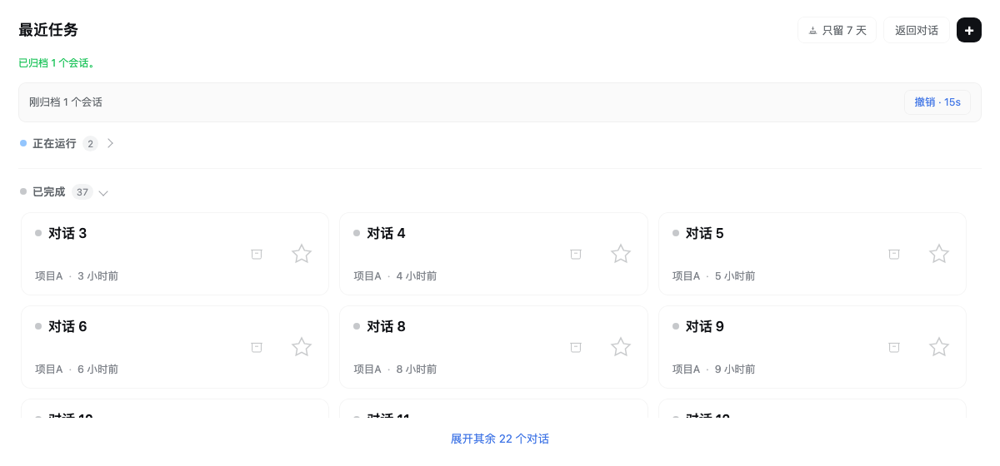
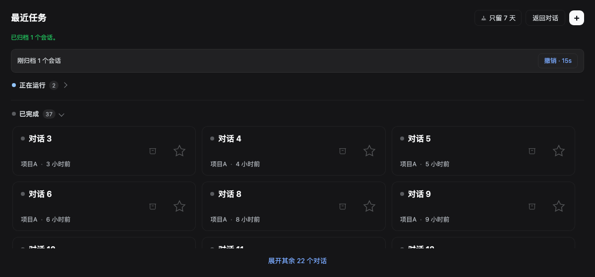

### 撤销：归档后 30 秒内可反悔

归档成功后，页头下面会出现一条撤销条：「刚归档 5 个会话」＋右侧【撤销 · 29s】倒计时。

- 点【撤销】就逐条走 `uiWorkspace.unarchiveSession` 还回去，条子收起，提示「已恢复 N 个会话。」
- 30 秒一到条子自己消失，再想恢复就去宿主的归档管理器。
- 只覆盖**这一批**：再点一次【只留 N 天】会把上一批的撤销条顶掉，不能连着撤两批。
- 部分失败时撤销条仍然出现，但它只记得**真正归档成功**的那几条。
- 宿主没有恢复接口时不出这条（避免给了按钮按下去没用），归档照常进行。
- 页面关掉或刷新后撤销条就不在了——它只活在这一次操作之后。

### 保留天数在设置里改

天数不再写死在按钮上，改成插件自己的一个设置项：

- 位置：**设置 → 插件 → 最近任务 → 配置**（`plugins.row.config` 那一格）。卡片标题「只留几天」，一个数字输入框（1–365，整数）加【保存】。
- 存的是 Host 侧的配置字段 `keepDays`。它在 `index.js` 里声明成 **volatile** 字段——这一点是刻意的：改它会走宿主的热更新通道，不会重启插件、不会重建页面、不会丢你正在看的列表；非 volatile 字段改一次会让插件重启，页面状态全没。
- 页面上没有任何入口能改这个数：按钮文案、确认框措辞、提示语都跟着设置走，但改只能去设置里改。这样「期限」不会因为手滑点一下就变了。
- 设置读不到（旧版本界面没有 `configForms` 服务，或该行还没被宿主登记）时，页面回落到默认 **7 天**并继续正常工作，不会因为读不到配置而不干活。

## 点【+】新建会话

1. **第一次**点击弹选择框：列出现有工作区，另有「选择其他文件夹…」调系统文件夹选择器（宿主 `uiWorkspace.pickDirectory`）。
2. 选中的文件夹被记住。它是已有工作区 → 直接在那个分组里新建会话并打开；不是工作区 → 先 `workspaces.create` 登记成工作区，再 `connectWorkspace` 建会话并打开。于是会话归入该分组，不会掉进「未分组」。
3. **之后**点【+】不再弹窗，直接用记住的文件夹。
4. 记住的文件夹被删 / 改名后就不可用，下次点【+】回到第 1 步重新选。

> 想主动换文件夹：目前没有独立按钮，只能等记住的那个失效后重新选，或清掉本地键 `dsh.recent-tasks.folder.v1`。

## 进面板时顺带解锁刷新

点侧栏「最近任务」时，先问宿主 `/dsh-unlag/graph` 当前服务的插件代码修订号，跟页面启动时记下的比：

- 一样 → 直接进页面，不折腾；
- 不一样、读不到、或 1.5 秒没回 → 借用界面右上角「解除卡顿」按钮触发一次整页重建，重建完自动回到最近任务页（`sessionStorage` 记一个 120 秒内有效的意图）；
- 宿主拒绝重建（正在发消息、有未发附件、开着弹窗等）→ 不解释，直接进页面，下次再说。

这样改完插件代码点一下入口就能看到新版本。代价是那一次多花约 3 秒。

## 本地存储

| 键 | 位置 | 存什么 |
| --- | --- | --- |
| `dsh.recent-tasks.folder.v1` | localStorage | 【+】用的文件夹绝对路径 |
| `dsh.recent-tasks.favorites.v1` | localStorage | 收藏的会话 id 列表 |
| `dsh.recent-tasks.unread.v1` | localStorage | 未读的会话 id 列表 |
| `dsh.recent-tasks.reopen.v1` | sessionStorage | 刷新重建后要回到本页的意图（120 秒过期） |

保留天数**不在**上面这些键里：它存在 Host 侧的插件配置（`keepDays`），跟着 profile 走，换浏览器也还在。

清掉这几个键就回到初始状态：没有收藏、没有未读、下次点【+】重新选文件夹。

## 文件

```
client.js              全部界面与逻辑（浏览器侧，约 2280 行）
index.js               Host 半边：声明 Config（一个 volatile 字段 keepDays）+ 空 apply；不注册 Service / Tool
package.json           包名带本机随机 id，宿主按这个名字查文件
cordis.patch.yml      让宿主把这包插进组合的一行 patch
icon.svg              侧栏图标
locale/zh.json         侧栏入口的中文名与描述（界面文案在 client.js 里，中英各一份）
locale/en.json         同上，英文
tools/build-harness.cjs   生成一个用假宿主跑 client.js 的自检页
tools/run-harness.mjs     无头 Chrome 打开自检页，打印每条检查结果
tools/sync-to-dsh.sh      把仓库文件同步进本机 DSH 实际加载的目录
```

## 装法（本机）

这份仓库是**源码**。界面实际加载的是 DSH 插件创建器产出的那份副本，profile 里用 `link:` 指向它：

```
~/.dsh/profiles/desktop/package.json
  "@dsh-local/view-8c716ee6-…": "link:…/created-plugins/8c716ee6-…"
```

所以改完（或拉下新版本）之后：

```bash
node tools/build-harness.cjs
node tools/run-harness.mjs "file://$PWD/临时/harness.html"   # 打印每条检查，期望 ALL PASS
tools/sync-to-dsh.sh                                        # 同步进加载目录（顺带 node --check）
```

然后点界面右上角那个打圈的刷新按钮（解除卡顿）。或者干脆点侧栏「最近任务」——它检测到代码变了会自己刷一次。

`tools/sync-to-dsh.sh --check` 只对比不写，用来确认两边是否一致。

## 自检

`tools/build-harness.cjs` 用一套假服务（会话列表、工作区、布局、`uiWorkspace`、`uiSession`）在普通浏览器里渲染 `client.js`，并跑 332 条检查：**侧栏入口的三个药丸（一枚都没事时什么也不画、只数运行中时是浅蓝、有人等你时红的那颗排最前、跑完没看的补上绿的那颗、处理完红的自己消失、收藏里的在跑也算、页面运行区仍只算没收藏的、收藏一变角标当场重算、侧栏收窄时不画、药丸排在「最近任务」四个字之后且不挤出按钮、收藏里没看的也算进绿的那枚但页面未读区不含收藏）**、**折叠（已完成区默认展开并直接画出 15 条、运行区默认收起且一张卡也不画、收起的区照样写计数、三角朝右点开后朝下再点回去；重挂载与点侧栏入口都回到这个形状，且不写本地存储；未读区没有三角、永远展开）**、**有人等你时那一区替你展开（运行区与收藏区各判各的、已完成永不自动开、只是跑着没人等仍然收着、页面开着时才转成等人的不弹开只加红标、重挂载与点侧栏入口都重新判、自动打开也不写本地存储）**、分区归属、收藏互斥、未读按轮与可见性、待确认排位与配色、四区配色与动效（运行蓝且在动、未读绿且不动、待确认不跟着动）、空区整块不出现（含顶上来时不带多余分隔线）、**卡片放大与收藏星（三列封顶、点击区 56px 见方、图标 30px、贴右 4px、竖向居中、未收藏时不带常驻底色、标题与说明让位、字号、窄宽度降列）**、**收藏卡状态标（运行中偏蓝、未读偏绿、已完成灰、待确认不重复加标、其它区不加标）**、`+` 的文件夹记忆与失效回退、展开条数、刷新桥的拒绝路径、**【只留 N 天】（按钮排位与文案随设置变、确认框措辞、未确认不归档、取消无效、确认后逐条归档的调用、收藏与运行中的不动、部分失败提示、宿主没有归档接口时的降级、页面上正好在 N 天边缘那几条的归属）**、**撤销条（归档后出现、文案与倒计时、位置在提示与列表之间、点撤销逐条恢复、不能恢复时的降级、部分失败只记成功那几条）**、**单张归档（每张已完成卡一颗纸箱按钮、其它区没有、44px 点击区、排在星星左边且不压标题说明、点一下不弹框只归档这一张、给结果提示与撤销条、撤销能放回原位、连点两张只撤最后一张、没有接口与接口报错的两种降级、归档进行中其余按钮先禁用）**、**保留天数配置（页头与提示跟着设置走、调小窗口能清掉十天内的旧会话、没有设置入口时回落 7 天、向插件管理器登记配置位、描述位文案、设置卡输入框与保存写入的字段值）**等。结果写在页面 `<title>` 和底部日志里。

- `临时/harness.html`：跑检查
- `临时/harness.html?preview`：静态浅色预览，就是**刚进面板的样子**：运行区收着、已完成区展开并列出 15 条
- `临时/harness.html?preview&foldall`：把到达时已展开的区也收起来，只剩标题行与条数
- `临时/harness.html?preview&expand`：三个区全部展开的样子；这个开关可以和别的开关叠着用，例如 `?preview&expand&favrun`
- `临时/harness.html?preview&pending`：三个会话分别停在等你确认 / 等你定方案 / 等你回答上，运行区因此是**展开**的（就是上面那条例外的样子）
- `临时/harness.html?preview&waitlater`：页面先到达、会话随后才转成等你处理，用来核对「不弹开、只加红标」那个样子
- `临时/harness.html?preview&dark`：静态深色预览
- `临时/harness.html?preview&unread`：三区都有的样子
- `临时/harness.html?preview&none`：一个都不在跑（只剩已完成）
- `临时/harness.html?preview&favrun`：正在跑的都进了收藏（运行区整块不出现，收藏在最上面）
- `临时/harness.html?preview&favstatus`：收藏里四种状态各一张卡（运行中 / 未读 / 等你确认 / 已完成）
- `临时/harness.html?preview&unread&freeze=1.1`：把动画停在 1.1 秒处再截图，用来核对流动光带的位置
- `临时/harness.html?preview&old`：塞 5 条 10 天外的老会话进去，让【只留 N 天】有活可干
- `临时/harness.html?preview&old&sweepdialog`：直接把归档确认框打开，用来核对方框措辞
- `临时/harness.html?preview&old&undo`：真的归档一批，让撤销条出现在截图里
- `临时/harness.html?preview&archone`：点一下第一张已完成卡上的纸箱按钮，看单张归档后留下的提示与撤销条（可叠 `dark`）
- `临时/harness.html?preview&config`：单独渲染插件设置里那张「只留几天」卡
- `临时/harness.html?preview&entry&pending&unread`：仿侧栏画一行「最近任务」，三个药丸都在（可叠 `dark`）

截图里是假数据（对话 1…20、项目A），只用于看形状与配色。

## 它不做什么

- 不改动会话本身：不迁移、不重命名、不删除，只负责打开。唯一的例外是【只留 N 天】和它的【撤销】——前者按你的确认去归档，后者只撤自己刚归档的那一批，见上一节。
- 不做会话检索、全文搜索、导出。
- 不跨设备同步收藏与未读；换浏览器就是另一份。
- 只列最近 10 天有活动的会话（收藏除外），更老的会话请用宿主侧栏。

## 已知边界

- **宿主接口名绑定**：依赖 `sessions` / `workspaces` / `uiWorkspace`（`openSession`、`connectWorkspace`、`pickDirectory`、`listDirectory`）/ `uiSession.sessionStatus` / `layout.panelInfo`、`layout.selectPanel` / `slots` / `locale`，以及 dsh-unlag 的 `/dsh-unlag/graph`。DSH 换版本时这些名字可能变，坏了先查这一层。
- **包名里的随机 id 是本机生成的**：`@dsh-local/view-8c716ee6-17d5-46ae-b021-c82f36d0f6c1`。换一台机器装，要么沿用这个 id，要么把 `package.json`、`cordis.patch.yml`、`client.js` 顶部 `id` 三处一起改。
- **取色用 DSH 主题变量**（`--dsw-alias-*`）；离开宿主渲染（自检页）时用 fallback 调色板，只保证可读，颜色不等于真机。
- 侧栏「取消固定」状态只存内存，整页重建后会复原；这是宿主行为，本插件没有干预。
- **设置页的落点依赖宿主的插件管理器**：注册 `plugins.row.config`，key 用「包名#行 id」（带 `include:` 前缀和不带各注册一次，因为两种装法下行的 id 不同）。宿主若换了这个挂点或这个 key 形状，设置卡就挂不上去——那时页面仍按默认 7 天工作，只是改不了。

## 版本

`0.1.0` — 开发中，未发布到插件市场。

## 许可

MIT
